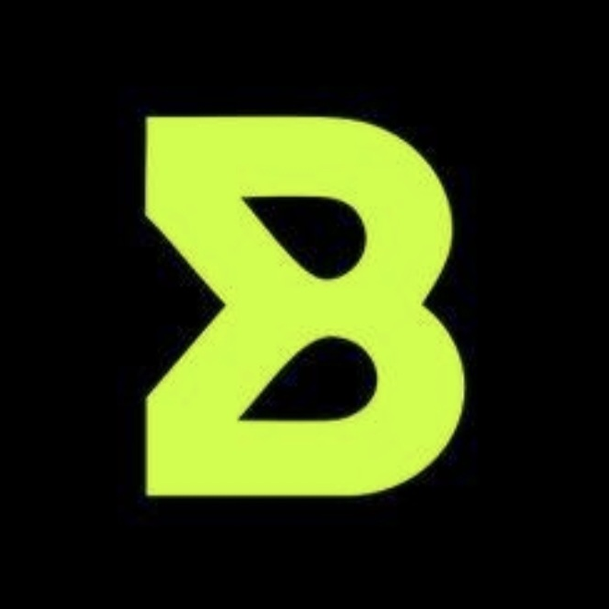
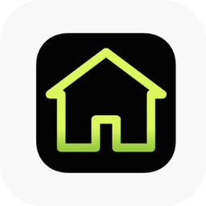
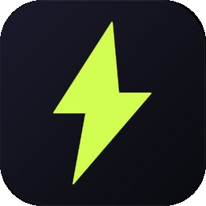
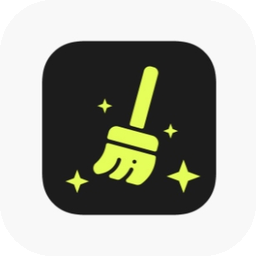
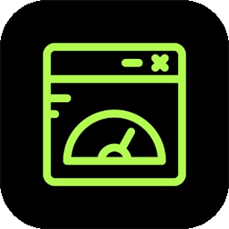
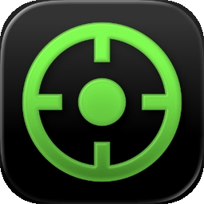
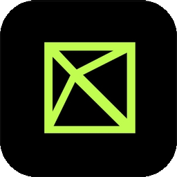
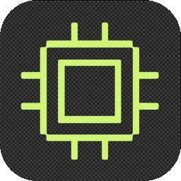
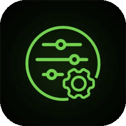

<p align="center"></p>

# Boosterik × SynhroBoost — Gaming Toolkit

Target of first release: **v1.0.0**

## Tabs
| Icon | Tab |
|---|---|
|  | Головна |
|  | Прискорення |
|  | Очищення |
|  | Програми |
|  | Приціли |
|  | Кольори |
|  | Драйвери |
|  | Налаштування |

## Features
3 optimization levels (Easy / Medium / High), Game Mode, Find FPS Losses, Custom Crosshairs, Color Profiles, Backup & Restore, GitHub Actions.

## Що вже працює
- **Прискорення:** 3 рівні (Легкий / Середній / Високий), Game Mode, Find FPS Losses, відкат змін.
- **Очищення:** тимчасові файли, дампи, кеш шейдерів, кошик.
- **Програми:** список за ЦП/пам'яттю, завершення, пріоритет.
- **Приціли:** накладка по центру екрана, власні PNG.
- **Кольори:** експозиція, гамма, тіні, контраст, насиченість + профілі.
- **Драйвери:** версія драйвера GPU і посилання на офіційні сайти.
- **Налаштування:** профіль (ім'я, прізвище, аватарка), адміністратор, резервна копія / відновлення, журнал.

Усі зміни системи зберігаються в `configs/backup.ini` перед першою оптимізацією й відкочуються кнопкою «Відкотити зміни».

## Build (Windows)
```
cmake -S . -B build -A x64
cmake --build build --config Release
```

## Workflow
One GitHub Issue per feature; Milestones: Alpha → Beta → Release.


## Дизайн: Claymorphism
Великі заокруглені кнопки, м'які об'ємні поверхні, пастельні кольори й подвійні тіні (зовнішня темна + світла, внутрішні світло/тінь).

| Роль | Колір |
|---|---|
| Background | `#F4EFFF` |
| Surface | `#FFFFFF` |
| Lavender | `#C9B6FF` |
| Purple | `#9B7BFF` |
| Pink | `#FFB8D2` |
| Blue | `#A8D8FF` |
| Mint | `#A9EBCB` |
| Text | `#38304D` |

Усі кольори й clay-примітиви (`Clay`, `Inset`, `Card`) — у `src/UI/Ui.h/.cpp`. Запуск починається з анімованого сплеш-екрана.

## Профіль
Налаштування → Профіль: ім'я, прізвище, аватарка (PNG/JPG/BMP/GIF) або кольорові ініціали. Дані зберігаються в `configs/profile.ini` та `configs/avatar.*`.
